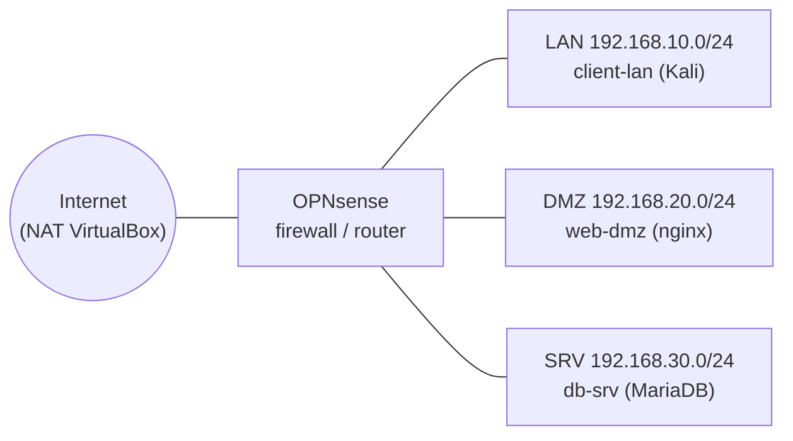
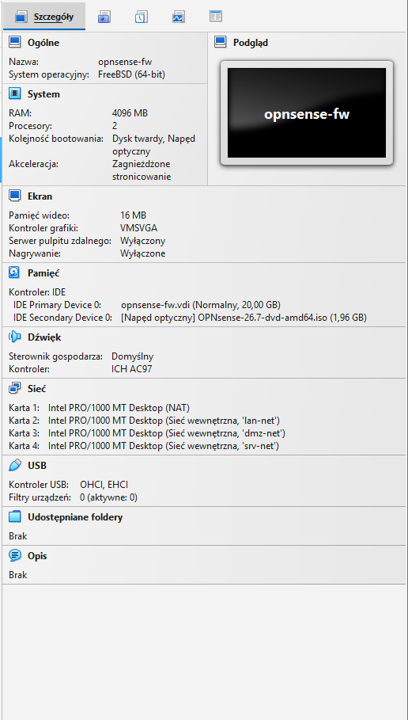
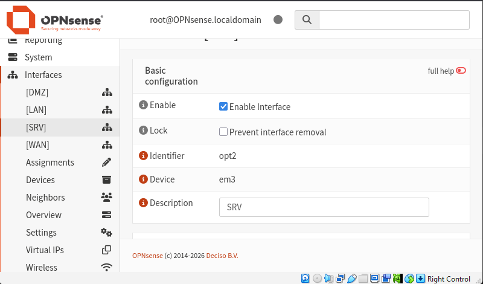
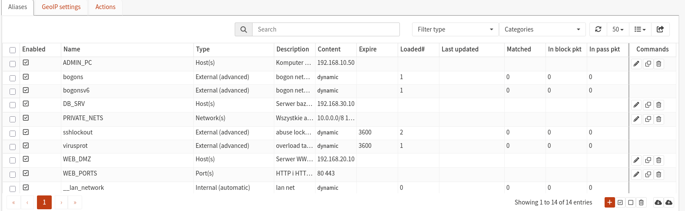
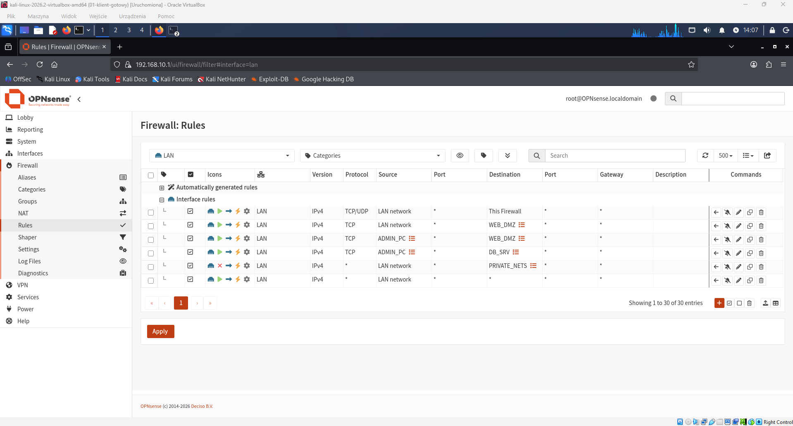
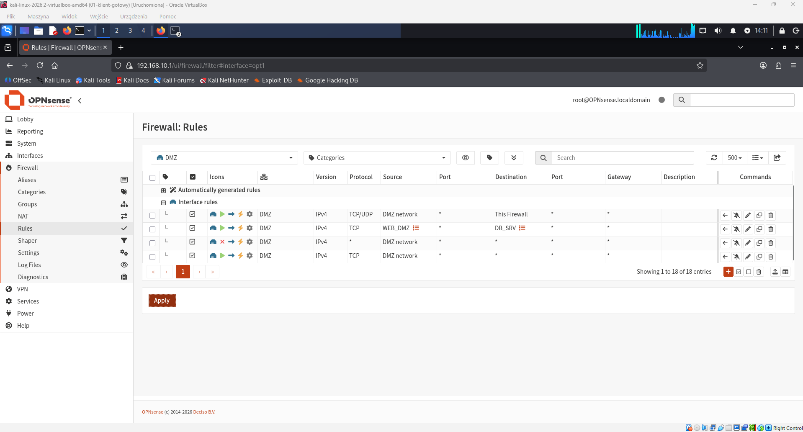
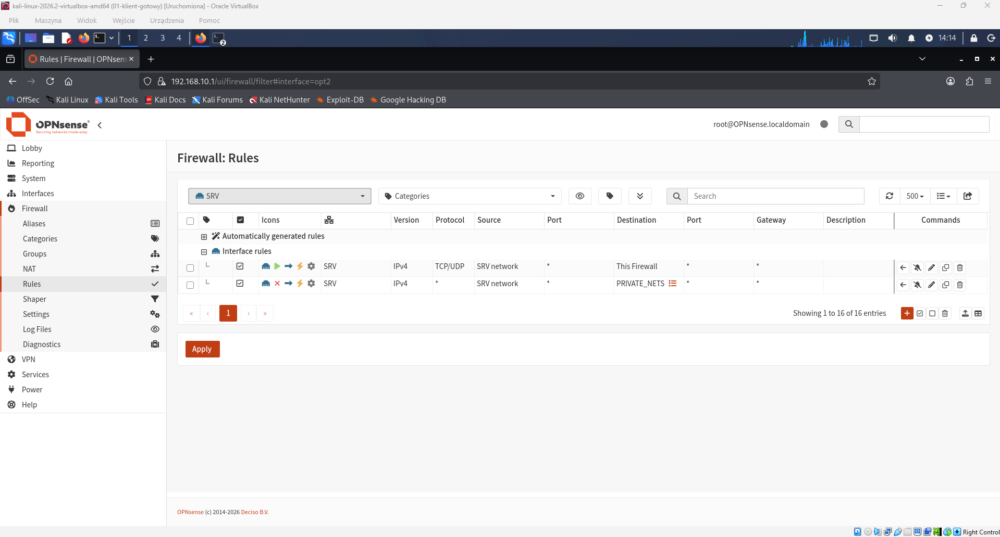
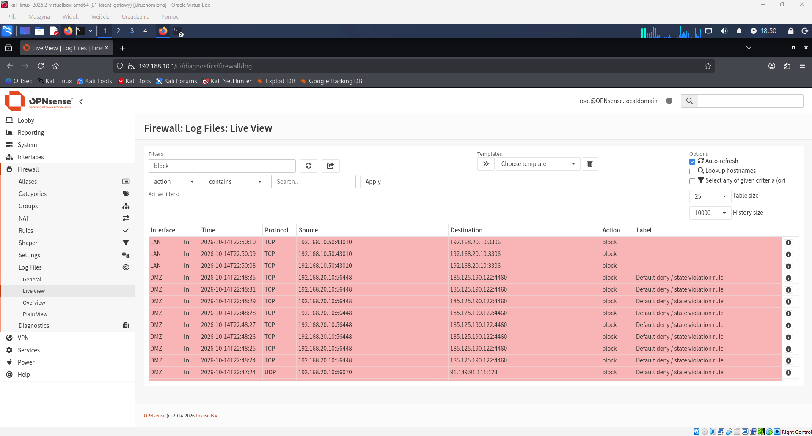

# Segmentacja sieci z firewallem OPNsense (VirtualBox)

Laboratorium pokazujące projekt i wdrożenie **segmentacji sieci** z zasadą najmniejszych uprawnień. Firewall **OPNsense** dzieli środowisko na trzy strefy (LAN, DMZ, SRV), a ruch między nimi jest dozwolony wyłącznie tam, gdzie wynika to z potrzeb. Polityka została zweryfikowana dziesięcioma testami (ruch dozwolony i zablokowany) oraz logami firewalla.

Całość działa na VirtualBoxie w odizolowanej sieci. W laboratorium nie ma podatnych maszyn ani złośliwego oprogramowania.

## Cel projektu

- Zaprojektować adresację i podział sieci na strefy zaufania.
- Wdrożyć politykę firewalla typu *default deny* z jawnie opisanymi wyjątkami.
- Zweryfikować politykę testami (ruch dozwolony i zablokowany) i logami.
- Udokumentować decyzje projektowe, napotkane problemy i wnioski.

## Architektura

| Strefa | Podsieć | Maszyna | Adres IP | System | Rola |
|---|---|---|---|---|---|
| WAN | 10.0.2.0/24 (NAT VirtualBoxa) | opnsense-fw | 10.0.2.15 | OPNsense 26.7 | Wyjście do internetu |
| LAN | 192.168.10.0/24 | opnsense-fw | 192.168.10.1 | OPNsense 26.7 | Brama, DHCP, DNS |
| LAN | 192.168.10.0/24 | client-lan | 192.168.10.50 | Kali Linux 2026.2 | Stacja administratora i użytkownika |
| DMZ | 192.168.20.0/24 | web-dmz | 192.168.20.10 | Ubuntu Server 26.04 LTS | Serwer WWW (nginx) |
| SRV | 192.168.30.0/24 | db-srv | 192.168.30.10 | Ubuntu Server 26.04 LTS | Serwer bazy danych (MariaDB) |

Strefy są sieciami wewnętrznymi VirtualBoxa (`lan-net`, `dmz-net`, `srv-net`). Maszyny z różnych sieci nie widzą się nawzajem, więc jedyną drogą między nimi jest firewall.

## Użyte technologie

Oracle VirtualBox, OPNsense, Kali Linux, Ubuntu Server, nginx, MariaDB, SSH, `nc` (netcat), `curl`, `mysql`, Git i GitHub.

## Polityka bezpieczeństwa

1. Domyślnie cały ruch między strefami jest blokowany.
2. LAN łączy się z serwerem WWW w DMZ wyłącznie po HTTP i HTTPS. SSH do serwerów tylko ze stacji administratora.
3. Serwer WWW (DMZ) łączy się z bazą danych (SRV) wyłącznie na porcie 3306.
4. DMZ nie może inicjować połączeń do LAN.
5. Strefa SRV nie ma dostępu do internetu ani do innych stref.
6. Zablokowany ruch wewnętrzny jest logowany.

### Macierz komunikacji

| Z \ Do | Internet | LAN | DMZ | SRV |
|---|---|---|---|---|
| **LAN** | dozwolone | n/d | 80, 443 (wszyscy), 22 (tylko administrator) | 22 (tylko administrator) |
| **DMZ** | 80, 443 | zablokowane | n/d | 3306 (tylko serwer WWW do bazy) |
| **SRV** | zablokowane | zablokowane | zablokowane | n/d |

Pełny opis reguł z uzasadnieniem: [docs/firewall-rules.md](docs/firewall-rules.md)

## Reguły firewalla (skrót)

| Interfejs | # | Akcja | Źródło | Cel | Port | Opis |
|---|---|---|---|---|---|---|
| LAN | 1 | Pass | LAN net | This Firewall | 53 | DNS |
| LAN | 2 | Pass | LAN net | WEB_DMZ | 80, 443 | Dostęp do serwera WWW |
| LAN | 3 | Pass | ADMIN_PC | WEB_DMZ | 22 | Administracja SSH |
| LAN | 4 | Pass | ADMIN_PC | DB_SRV | 22 | Administracja SSH |
| LAN | 5 | Block (log) | LAN net | PRIVATE_NETS | any | Reszta ruchu wewnętrznego |
| LAN | 6 | Pass | LAN net | any | any | Internet |
| DMZ | 1 | Pass | DMZ net | This Firewall | 53 | DNS |
| DMZ | 2 | Pass | WEB_DMZ | DB_SRV | 3306 | Aplikacja do bazy |
| DMZ | 3 | Block (log) | DMZ net | PRIVATE_NETS | any | Brak ruchu do LAN i SRV |
| DMZ | 4 | Pass | DMZ net | any | 80, 443 | Aktualizacje |
| SRV | 1 | Pass | SRV net | This Firewall | 53 | DNS |
| SRV | 2 | Block (log) | SRV net | PRIVATE_NETS | any | Izolacja strefy |

## Wyniki testów

Plan testów, polecenia i dowody: [docs/test-plan.md](docs/test-plan.md)

| ID | Z | Do | Port | Oczekiwany wynik | Wynik |
|---|---|---|---|---|---|
| T1 | LAN | Internet | 443 | Dozwolone | OK |
| T2 | LAN | DMZ (WWW) | 80 | Dozwolone | OK |
| T3 | LAN | DMZ | 3306 | Zablokowane | OK |
| T4 | LAN | SRV | 3306 | Zablokowane | OK |
| T5 | LAN (admin) | DMZ | 22 | Dozwolone | OK |
| T6 | DMZ | LAN | 22 | Zablokowane | OK |
| T7 | DMZ | SRV | 3306 | Dozwolone | OK |
| T8 | DMZ | SRV | 22 | Zablokowane | OK |
| T9 | SRV | Internet | 443 | Zablokowane | OK |
| T10 | SRV | LAN | 22 | Zablokowane | OK |

**10 z 10 testów zgodnych z oczekiwaniami.** Zablokowany ruch kończy się przekroczeniem czasu (`timed out`) i jest widoczny w logach firewalla.

## Zrzuty ekranu

| Opis | Plik |
|---|---|
| Karty sieciowe firewalla w VirtualBoxie |  |
| Interfejsy LAN, WAN, DMZ i SRV |  |
| Aliasy |  |
| Reguły LAN |  |
| Reguły DMZ |  |
| Reguły SRV |  |
| Zablokowany ruch w logu (Live View) |  |

Zrzuty z poszczególnych testów (`T1.png` do `T10.png`) są w folderze `screenshots/`.

## Napotkane problemy i wnioski

1. **Odłączenie płyty ISO w trakcie działania instalatora.** System uruchomiony z płyty (tryb *live*) po jej wyjęciu zaczął zgłaszać błędy odczytu (`pager read error`), a maszyna się zawiesiła. Rozwiązanie: ponowna instalacja i ustawienie kolejności rozruchu z dyskiem twardym na pierwszym miejscu, dzięki czemu płyta przestała być potrzebna po instalacji. Wniosek: nośnik instalacyjny odłącza się dopiero po zakończeniu instalacji i poprawnym starcie z dysku.
2. **Wirtualny dysk niepodpięty do maszyny.** Instalator zgłaszał brak miejsca (*minimum size 4GB was not met*), a później maszyna nie znajdowała systemu. Rozwiązanie: sprawdzenie ustawień **Pamięć** w VirtualBoxie i ponowne podpięcie dysku 20 GB.
3. **Niekompletnie rozpakowany obraz Kali.** Maszyna kończyła start w trybie `grub rescue`. Dysk po rozpakowaniu miał ok. 5 GB zamiast ok. 15 GB. Rozwiązanie: ponowne rozpakowanie archiwum z kontrolą błędów. Wniosek: warto sprawdzać rozmiar plików po rozpakowaniu i test archiwum.
4. **Brak miejsca na dysku komputera (`VERR_DISK_FULL`).** Instalacja serwera została wstrzymana. Rozwiązanie: zwolnienie miejsca, usunięcie niedokończonej maszyny i przeniesienie maszyn na dysk z większą ilością wolnego miejsca. Wniosek: dyski dynamiczne rosną, a migawki dodatkowo zwiększają zużycie miejsca.
5. **Test T8 dawał `succeeded` zamiast `timed out`.** Ruch, który miał być zablokowany, przechodził. Rozwiązanie: sprawdzenie w *Live View*, która reguła przepuszcza pakiet, przegląd listy reguł DMZ (kolejność, zakres portów, tymczasowe reguły) i poprawka. Wniosek: reguła Pass bez ograniczenia portu lub pozostawiona tymczasowa reguła niweczy segmentację, a testowanie blokad jest równie ważne jak testowanie ruchu dozwolonego.
6. **Błąd 2026 (TLS) i 1045 (odmowa dostępu) przy połączeniu z bazą.** Błąd 2026 wynikał z domyślnego wymogu szyfrowania po stronie klienta MariaDB (w laboratorium użyto `--skip-ssl`). Błąd 1045 oznaczał, że ruch dotarł do bazy, a odrzucone zostało dopiero uwierzytelnianie. Rozwiązanie: odtworzenie konta `web`@`192.168.20.10` z poprawnymi danymi. Wniosek: kod błędu pokazuje, na której warstwie jest problem (sieć, firewall, szyfrowanie, uwierzytelnianie). W produkcji należy skonfigurować TLS na serwerze bazy zamiast je wyłączać.
7. **Konto `root` zablokowane na Ubuntu Server.** Logowanie na `root` kończyło się komunikatem `Login incorrect`. Rozwiązanie: logowanie na konto utworzone podczas instalacji i używanie `sudo`. Wniosek: to celowe zabezpieczenie systemu.

### Wnioski ogólne

- Reguły są oceniane od góry do dołu, więc **kolejność** ma kluczowe znaczenie (np. blokada ruchu wewnętrznego musi stać nad regułą dopuszczającą internet).
- Podejście *default deny* i zasada najmniejszych uprawnień ograniczają skutki przejęcia pojedynczego serwera: przejęty serwer WWW w DMZ nie ma drogi do LAN, a serwer bazy nie ma drogi do internetu.
- Konto bazy danych ograniczone do adresu serwera WWW i do niezbędnych uprawnień (odczyt, dodawanie, zmiana) stanowi drugą warstwę ochrony obok firewalla.
- Logi firewalla są nie tylko dowodem, ale i narzędziem diagnostycznym.

## Możliwe rozszerzenia

- Suricata (IDS) w trybie detekcji na interfejsie DMZ i test alertów podczas skanowania `nmap`.
- VLAN-y zamiast osobnych sieci wewnętrznych.
- Dostęp administracyjny przez VPN (WireGuard) i logowanie SSH kluczem.
- TLS w połączeniu z bazą danych.
- Centralne zbieranie logów firewalla do SIEM (np. Wazuh).
- Zautomatyzowanie testów skryptem, który wykonuje tabelę testów i generuje raport.

## Jak odtworzyć laboratorium (w skrócie)

1. Utwórz w VirtualBoxie maszynę OPNsense z czterema kartami: NAT oraz trzy sieci wewnętrzne (`lan-net`, `dmz-net`, `srv-net`).
2. Zainstaluj OPNsense, przypisz interfejsy (em0 WAN, em1 LAN, em2 DMZ, em3 SRV) i ustaw adres LAN 192.168.10.1/24 z serwerem DHCP.
3. W panelu włącz interfejsy DMZ (192.168.20.1/24) i SRV (192.168.30.1/24).
4. Utwórz aliasy z sekcji reguł.
5. Zainstaluj maszyny: klient w LAN (192.168.10.50), serwer WWW w DMZ (192.168.20.10, nginx) i serwer bazy w SRV (192.168.30.10, MariaDB). Na czas instalacji użyj tymczasowych reguł Pass, a po instalacji usuń je.
6. Skonfiguruj bazę: nasłuch na adresie serwera i konto ograniczone do adresu serwera WWW.
7. Dodaj reguły firewalla zgodnie z [docs/firewall-rules.md](docs/firewall-rules.md).
8. Wykonaj testy z [docs/test-plan.md](docs/test-plan.md).

## Uwagi

Laboratorium jest w pełni odizolowane (sieci wewnętrzne VirtualBoxa). W repozytorium nie ma haseł, kluczy SSH ani pliku `config.xml` firewalla.
